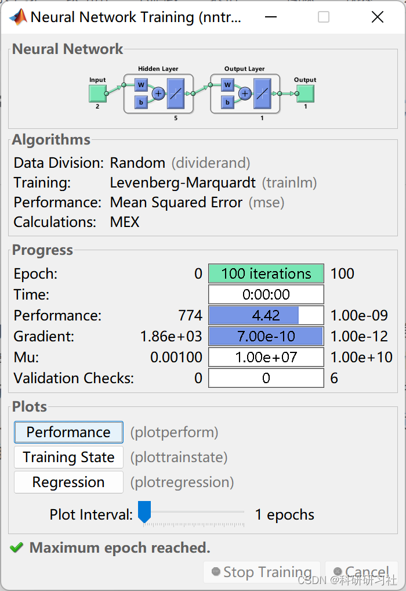
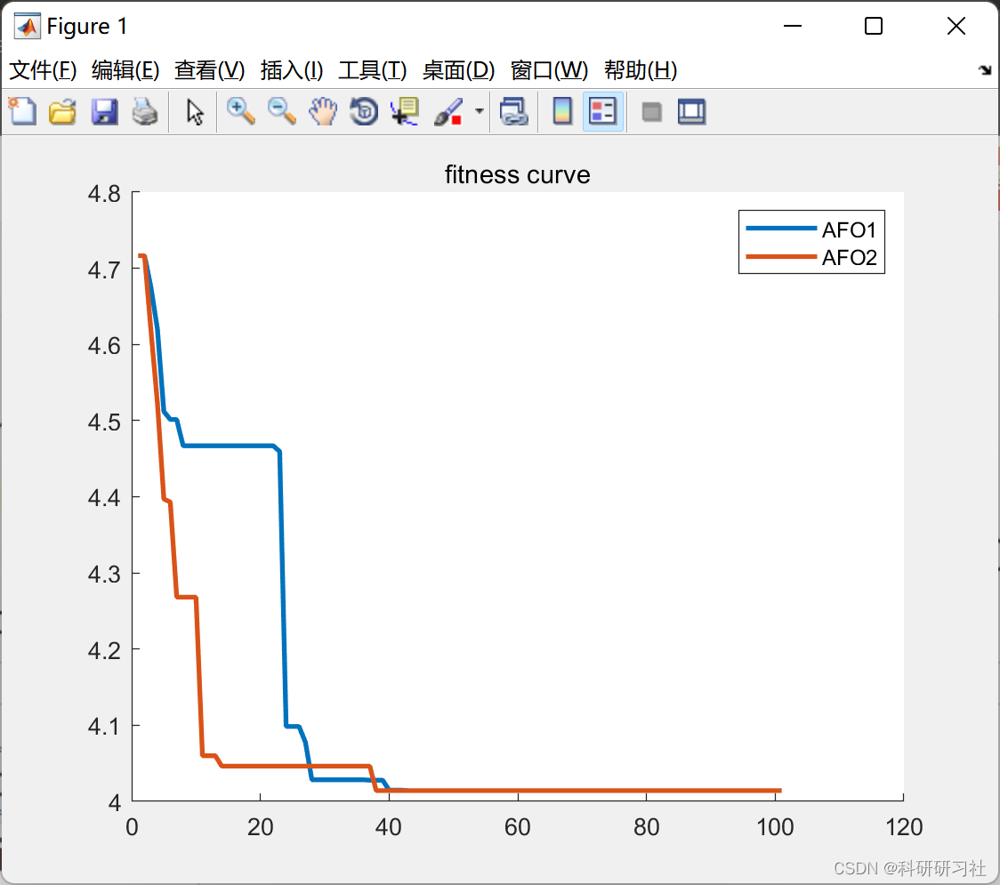
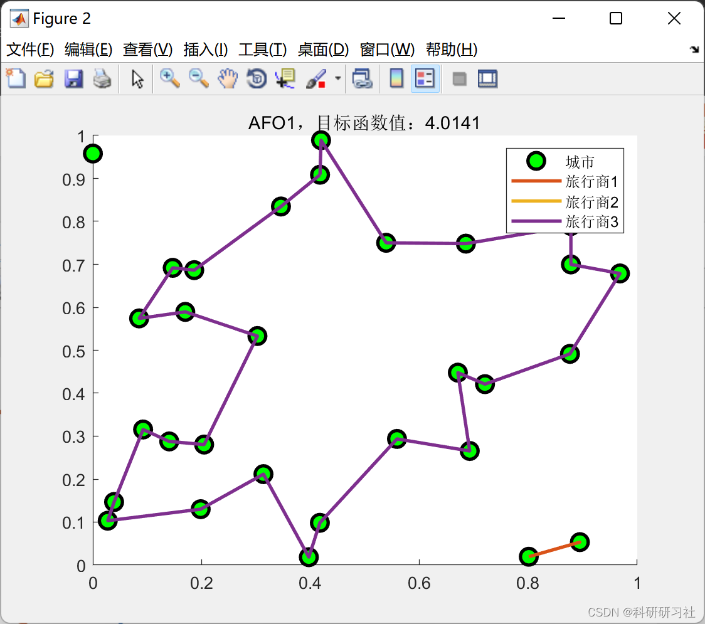
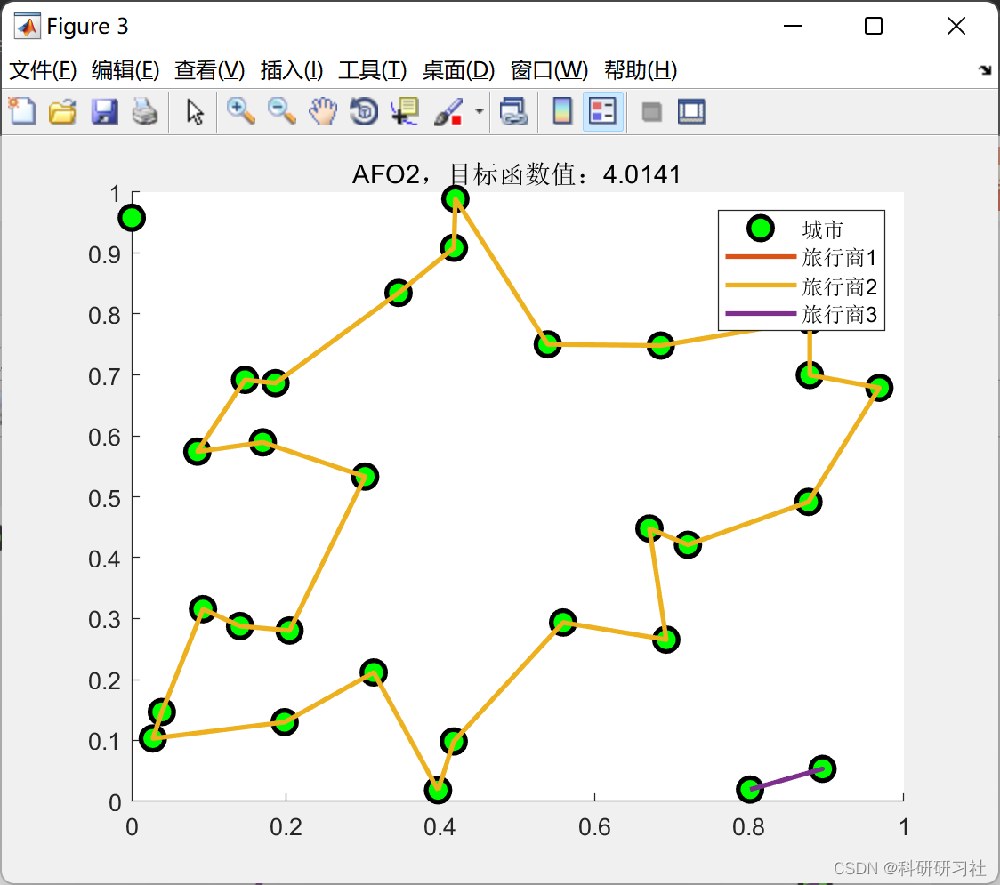

# Path Optimization: Solving TSP Problem Based on Emperor Penguin Algorithm (Matlab Code Implementation)

1. The Emperor Penguin Algorithm
Currently, there is a limited amount of research on the Emperor Penguin Algorithm both domestically and internationally. This paper analyzes the algorithm and compares it with common particle swarm optimization (PSO) and firefly algorithm. Emperor Penguins engage in various activities such as hunting and group foraging, which are characteristic of solitary animals. When harsh weather arrives, they congregate to protect themselves from the wind and cold. During the extreme winters of Antarctica, Emperor Penguins primarily warm each other by clustering together to endure the -40°C temperatures. To ensure that every penguin can stay warm, each contributes equally, and their social behavior is extremely cohesive and well-defined.
Run Results
Edit
Edit
Edit
Edit
%% Emperor Penguin Algorithm: TSP Problem\n% AFO TSP problems\n%% Quantity is fixed\n% TSP issues with different starting points and a fixed number of travellers\n%% This is the direct solution using the original algorithm, and adding an update method specifically for this problem can further improve precision.\n% This is the direct result of using the original algorithm, \n% adding some specific update methods to this problem can further improve the accuracy\nclc;\nclear;\nclose all;\nwarning off\n%% Fixed seed for random number generation\nnoRNG=1;\nrng('default')\nrng(noRNG)\n%% Loading data\ndata.maxTraveler=3; % Number of traveling salesmen\ndata.numCity=30; % Number of cities\n%% Randomly generate a city\ndata.xyCity=rand(data.numCity,2);\nfor i=1:data.numCity\n    for j=1:data.numCity\n        data.D(i,j)=norm(data.xyCity(i,:)-data.xyCity(j,:));\n    end\nend\n%%\noption.dim=data.numCity;\nlb=0;\nub=1;\noption.lb=lb;\noption.ub=ub;\nif length(option.lb)==1\n    option.lb=ones(1,option.dim)*option.lb;\n    option.ub=ones(1,option.dim)*option.ub;\nend\noption.fobj=@aimFcn_1;\n%option.fobj0=option.fobj;\noption.showIter=0;\n%% Algorithm parameter settings\n% Basic parameters\noption.numAgent=200;        % The number of individuals in the population\noption.maxIteration=100;    %Maximum number of iterations\n% Emperor Penguin Algorithm\noption.v_lb=-(option.ub-option.lb)/4;\noption.v_ub=(option.ub-option.lb)/4;\noption.w2=0.5; %weight of Moving strategy III\noption.w4=1;%weight of Moving strategy III\noption.w5=1;%weight of Moving strategy III\noption.pe=0.01; % rate to judge Premature convergence\noption.gap0=ceil(sqrt(option.maxIteration*2))+1;\noption.gapMin=5; % min gap\noption.dec=2;    % dec of gap\noption.L=10;     % Catastrophe\nstr_legend=[{'AFO1'},{'AFO2'}];\n%% Initialize population individuals (common to control experiment algorithm)\nx=ones(option.numAgent,option.dim);\ny=ones(option.numAgent,1);\nfor i=1:option.numAgent\n    x(i,:)=rand(size(option.lb)).*(option.ub-option.lb)+option.lb;\n    y(i)=option.fobj(x(i,:),option,data);\nend\n%% Algorithm for solving\n% Based on the same population, solve the selected  functions by using different algorithms\nbestX=x;\nrng(noRNG)\ntic\n[bestY(1,:),bestX(1,:),recording(1)]=AFO1(x,y,option,data);\ntt(1,1)=toc;\nrng(noRNG)\ntic\n[bestY(2,:),bestX(2,:),recording(2)]=AFO2(x,y,option,data);\ntt(1,2)=toc;\n%%\nfigure\nhold on\nfor i=1:length(recording)\n    plot((recording(i).bestFit),'LineWidth',2)\nend\nlegend(str_legend)\ntitle('fitness curve')\n\n%% Output result\nstr='AFO1'\n[~,result1]=option.fobj(bestX(1,:),option,data);\ndrawPc(result1,option,data,str)\nstr='AFO2'\n[~,result2]=option.fobj(bestX(2,:),option,data);\ndrawPc(result2,option,data,str)\n  
​  

## Images

<!-- PAYMENT_BLOCK -->

## Get this dataset

- Payment link (Stripe): [Buy now](https://buy.stripe.com/3cs8yP7sY87d0vu9AB)
- Payment QR code: 

<!-- /PAYMENT_BLOCK -->
